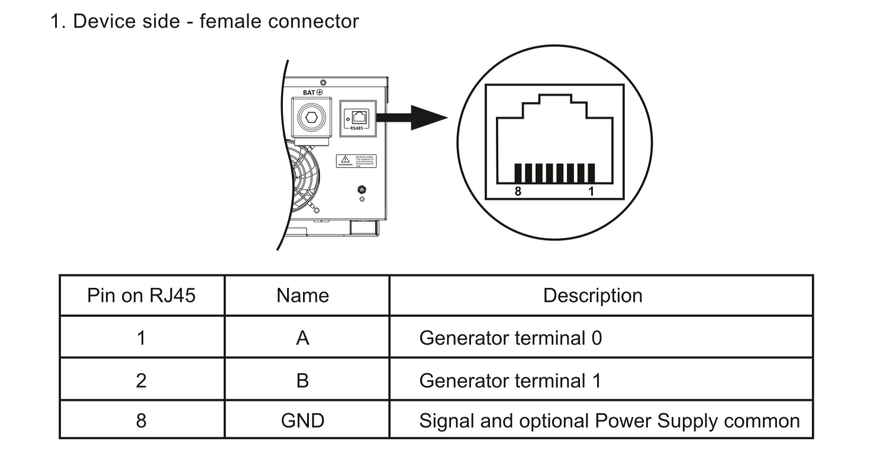
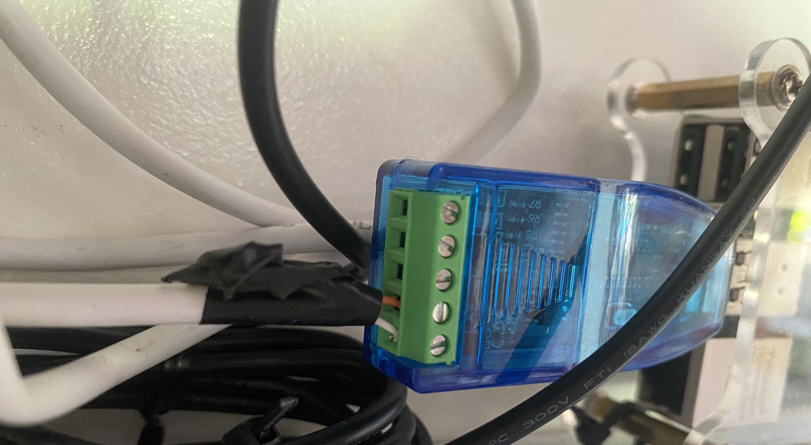
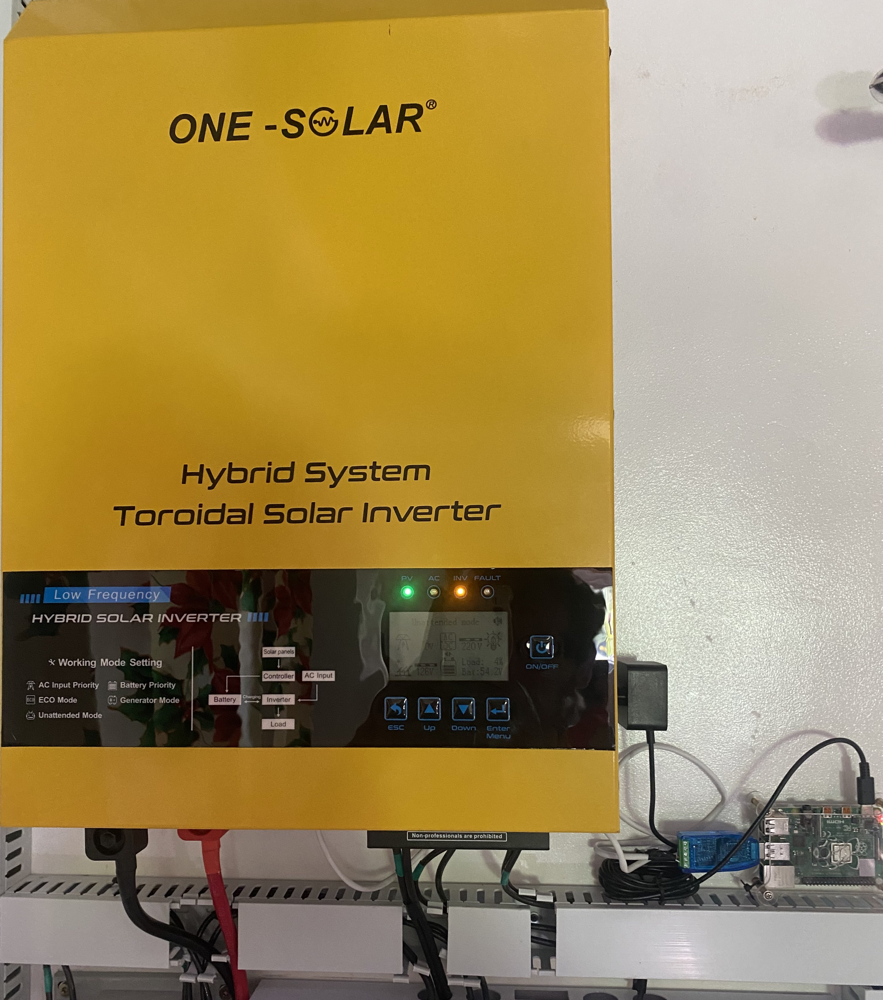
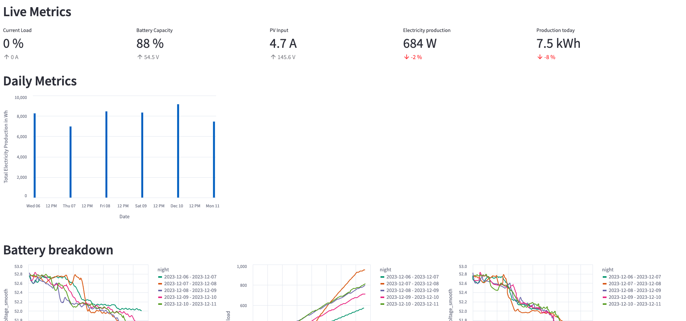
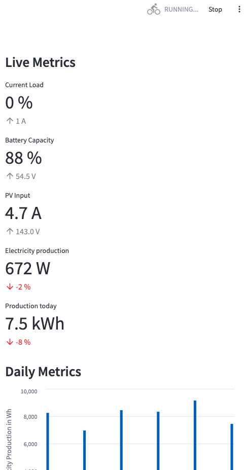

# Communication Script for "One Inverter" Hybrid Solar Inverter

**CURRENTLY STILL A WORK IN PROGRESS**

A couple of months ago, I installed my first PV System. With a budget in mind, I opted for the 48V 6kW Hybrid Inverter from "One Inverter," also known as "One Solar." Surprisingly, it featured an RJ45 port, enabling serial communication with the device. It utilizes the RS-485 standard for point-to-point communication and implements the Modbus protocol.

After contacting the company, they provided me with the API for their Modbus specifications.

The `run.py` script in this repository allows connection to the inverter and reads all relevant input registers. It operates continuously, saving the data every 3 seconds to a CSV file. A new CSV file is created daily.

Additionally, `dashboard/app.py` offers a simple Streamlit dashboard for displaying these values.

Set up on a Raspberry Pi, this configuration enables easy access to the inverter's metrics from any browser on a mobile or desktop device, anytime and anywhere.

The original setup used a USB-to-RS485 adapter between the inverter's RJ45
communication port and the Raspberry Pi. See the photos below and confirm the
pinout against the manufacturer documentation for your exact model.


## Deployment:

Create a Python environment and install the reader dependencies:

```sh
python3 -m venv venv
venv/bin/python -m pip install -r requirements.txt
```

Both readers create their output folders automatically. `run.py` writes to
`data/`; `run_meter.py` writes to `data_meter/`. The numeric CSV column names
and timestamp column are retained for compatibility with the dashboard.

The serial port defaults to `/dev/ttyUSB0`. To select an adapter explicitly:

```sh
SERIAL_PORT=/dev/serial/by-id/YOUR_ADAPTER venv/bin/python run.py
```

For a systemd service, add `Environment=SERIAL_PORT=/dev/serial/by-id/YOUR_ADAPTER`
under `[Service]` if needed. The supplied service files contain example user
and installation paths; replace them with your own.

The two service files are deployment examples, not a coordinated shared-bus
poller. Do not run two independent Modbus masters against the same serial
adapter/bus. Use separate adapters/buses or a single coordinated poller when
connecting both devices.

For the optional dashboard:

```sh
venv/bin/python -m pip install -r requirements-dashboard.txt
venv/bin/streamlit run dashboard/app.py
```

Start the inverter reader and let it record a sample before opening the dashboard.
The dashboard currently expects today's CSV file to exist. Register meanings,
scaling, and wiring must be checked against the exact inverter model and its
manufacturer documentation; this repository does not establish compatibility
with other models.

* adjust inverter.service and meter.service
* move them to: `/etc/systemd/system/`

```
sudo systemctl daemon-reload
sudo systemctl enable inverter.service
sudo systemctl start inverter.service
```

Enable and start `meter.service` separately after configuring its adapter/bus.

## Tests

```sh
venv/bin/python -m unittest discover -s tests -v
```

The tests use simulated serial responses and dashboard UI calls. They check
fresh-start logging, CSV compatibility, serial-port configuration, recovery
after a timeout, and the dashboard refresh delay. They do not require hardware
or verify register meanings.












